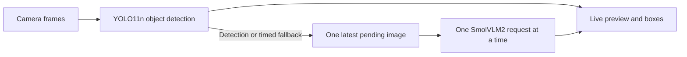

# Live construction-scene analysis on Jetson Orin Nano

This project studies whether an 8 GB Jetson Orin Nano can keep camera capture running while a local vision-language model describes construction scenes. The work progressed from static-image benchmarks to sequential camera experiments and then to a recorded concurrent pipeline.

**Latest result.** In five recorded trials, the camera delivered frames during all **111 completed SmolVLM requests**. Mean inference was **1.349 s**, mean capture-to-answer delay was **1.625 s**, and sampled whole-system RAM peaked at **4,413 MB**. Reliable detection of falls, rollovers, and obstructions remains an open research question. [Meeting log and five MP4s](docs/research-log/2026-11-24-meeting-log.md) · [Measurements and submitted images](docs/research-log/2026-11-24-five-video-results.md)

## Research progression

| Stage | What we learned | Evidence |
|---|---|---|
| **Sep 21 · Find a model that fits** | Moondream FP16 and generic INT8 produced no completed image tasks. The official 4-bit checkpoint completed all seven tasks and measured a 1.8969 GiB loaded footprint. | [Static-image benchmarks](docs/research-log/2026-09-21-moondream-benchmarks.md) |
| **Sep 28 · Connect the CSI camera** | The first camera trial analyzed two frames. A repetitive answer on the second frame prompted an early stop and motivated a repeatable sampling protocol. | [Camera feasibility test](docs/research-log/2026-09-28-moondream-live-camera.md) |
| **Oct 5 · Establish a camera baseline** | Captured six images from each of five clips and analyzed them afterward. Mean inference was 8.3241 s across 30 images. Sampled peak system RAM was 5,400 MB. | [Five-video Moondream baseline](docs/research-log/2026-10-05-moondream-camera-benchmark.md) |
| **Oct 21–22 · Test overlap and shorten answers** | Concurrent Moondream attempts encountered allocation and startup failures. A separate successful sequential run averaged 4.4612 s over 30 images with a shorter prompt and fresh captures. | [Concurrent attempts](docs/research-log/2026-10-21-moondream-concurrent-camera.md) · [Sequential comparison](docs/research-log/2026-10-22-camera-benchmark-comparison.md) |
| **Nov 5–12 · Change the architecture** | Reviewed smaller VLMs, built a gated pipeline, and resolved a TensorRT engine build failure. The first successful live trial delivered 1,569 frames at 26.14 FPS. Capture continued during all nine requests. | [Design review](docs/research-log/2026-11-05-live-inference-research.md) · [First concurrent run](docs/research-log/2026-11-12-first-concurrent-camera-benchmark.md) |
| **Nov 24 · Record all five clips live** | Recorded the preview, YOLO boxes, and captions. All five clips finished. The recordings expose missed posture cues, glare-related mistakes, and inconsistent equipment labels. | [Watch the five clips](docs/research-log/2026-11-24-meeting-log.md#recorded-results) · [Full results](docs/research-log/2026-11-24-five-video-results.md) |

The stages used different models, prompts, sampling policies, and timing scopes. Use the linked experiment notes when comparing performance. Loaded model footprint, checkpoint size, and whole-system RAM are separate measurements.

## How the current pipeline works

YOLO provides boxes and a fast signal for choosing images. SmolVLM produces a caption for the selected image. The latest frame replaces older pending work while the VLM is busy. The preview displays the caption with the image it describes, so readers can distinguish it from the current camera view. [Architecture and deployment](docs/scout-inspector-architecture.md)

The next experiment is to annotate event windows in the original videos and compare single-image captions with short histories of tracked people and equipment. Evaluate event recall, false alarms, and alert delay alongside FPS and RAM. [Research priorities](docs/research-log/2026-11-24-meeting-log.md#what-to-improve-next)

## Find your way around

| Where | Contents |
|---|---|
| [Research log](docs/research-log/README.md) | Full reading order, including design notes and failed attempts |
| [Research context](docs/context.md) | Working notes, deployment history, and open issues |
| [Current application](src/scout_inspector/) | Camera, detector, and VLM runtime |
| [Experiments](experiments/) | Launchers and historical benchmark scripts |
| [Results](results/) | Saved evidence linked from each experiment note |
