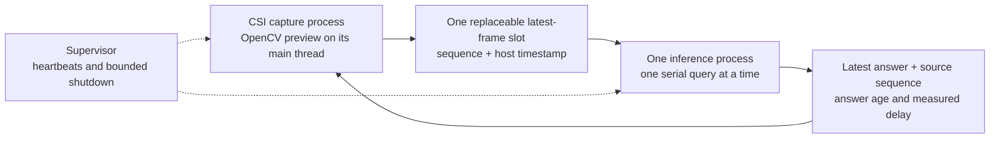

# Research review: moving from saved images to live descriptions — November 5, 2026

## Outcome of this session

Reviewed saved results, concurrent capture code, cached model implementation,
and primary model/deployment documentation. Produced a ranked model shortlist,
a concurrency design review, and a staged live-validation plan. **No new camera
run, GPU inference, model download, dependency installation, or performance
benchmark was performed. No new measured speedup is claimed.**

Recommendation: prioritize a reliable latest-frame live pipeline and a smaller
visual workload rather than another round of increasingly terse prompts.
Keep the existing working Moondream/PyTorch/CUDA environment intact.

## Established evidence and limits of prompt optimization

| Recorded result | Measurement | Evidence |
|---|---:|---|
| October 5 mean inference, 30 images | 8.3241 s | `results/camera_v2-2~2026-10-05/analysis.json` |
| October 22 mean inference, 30 images | 4.4612 s | `results/camera_analysis_20261022T163529601772802/analysis_fast.json` |
| Observed latency reduction | 46.41% | Computed from those means; different prompts and fresh captures |
| Image encoding / prefix preparation | 3.9174 s, 87.81% of total | October 22 per-frame stage timings |
| Query / text generation | 0.5437 s, 12.19% | Same saved measurements |
| Mean after first image | 4.2243 s | Remaining 29 samples; encoding 3.6905 s, query 0.5338 s |
| Peak system RAM / CUDA allocation | 5401 MB / 2.4977 GiB | Same JSON and `analysis_fast_tegrastats.txt` |
| Concurrent live descriptions | Not demonstrated | `results/live_compare_20261022T160402845773289/video_01/analysis.json` has zero frames/pairs |

The reported encoding interval includes vision processing, image-prefix text
prefill and first-use setup; it is **not a measurement of the vision encoder
alone**. Split these components before deciding which backend to optimize.
The initial latency reduction also traded detailed prose for short labels and
used fresh camera images; it is not an isolated runtime or accuracy improvement.

Using the recorded means as a simple cost model:

- Removing the entire query stage would save at most 12.19% if encoding stayed
  unchanged. Actual savings from shorter output would be smaller.
- Hypothetically halving the measured encoding stage gives
  `3.9174 / 2 + 0.5437 = 2.5024 s`, or 43.91% less time than 4.4612 s.
- Neither hypothetical is a measured result or a prediction for a new model.
  Smaller parameter count alone does not predict latency, RAM, or answer quality.

Prompt optimization is not mathematically exhausted: formatting, relevance,
quality, repetition and model-specific instruction following still matter. It
simply has a much smaller remaining runtime target in this measured setup.

## New source-level observations

The pinned cached model source lives under:

`/home/charlotte/.cache/huggingface/modules/transformers_modules/moondream/moondream_hyphen_2b_hyphen_2025_hyphen_04_hyphen_14_hyphen_4bit/a89c59223ef8b5bb7826780728eeec172727ca84/`

| Observation | Local source | Implication / qualification |
|---|---|---|
| Default model construction uses BF16; the vision builder uses ordinary `nn.Linear(..., dtype=dtype)` | `moondream.py:69`, `vision.py:92` onward | The release name “4-bit” does not mean every vision operation runs in INT4. This is source inspection, not new runtime dtype profiling. |
| INT4 linear handling expands packed values and applies TorchAO quantization lazily on first use | `layers.py:33` onward | Persistent footprint alone cannot describe transient initialization needs. This is a hypothesis to profile, not proof of the Argus failure's root cause. |
| A model compile path includes `_vis_enc`, image-prefix prefill and decoding | `moondream.py:171` onward | A future optimization candidate. It also unpacks quantized modules and introduces compilation/warmup cost; do not enable blindly on a memory-sensitive Jetson. No compile benchmark completed. |
| KV caches and EncodedImage prefix reuse already exist | `moondream.py:47,139,207,356`, `text.py:41` | Do not claim newly enabled KV caching. Same-image multi-question reuse avoids duplicate encoding; new camera evidence still needs processing. |

Some first-use quantization may increase transient resource needs, but the saved
live failure occurred before a completed first query. It cannot be blamed on
first-query behavior alone without finer phase evidence.

## Why our concurrent implementation needs another design iteration

Saved live attempt: `results/live_compare_20261022T160402845773289/`.
Its startup snapshot showed 5887 MiB available RAM and no Codex in the saved
largest-process list. The model recorded a 25.8171 s load and 1.8969 GiB footprint,
but Argus reported buffer allocation failure and `InsufficientMemory` while
loading. There were no live answers. Closing Codex improved model-only headroom
previously; it did not solve the combined CSI/model problem.

Static code review of `experiments/moondream_4bit_camera_live.py` found:

1. Main calls native `camera.read()` while the worker loads/uses CUDA. A driver
   stall can prevent main from reaching stop checks or updating preview.
2. The signal handler only sets a threading event. It cannot reliably interrupt
   a blocked native read/release or GPU call.
3. The `while thread.is_alive(): thread.join(timeout=0.2)` loop has no overall
   shutdown deadline. Short join calls do not bound total waiting.
4. The latest-frame slot already prevents a frame backlog, but does not address
   native blocking or guarantee that shared-memory allocations succeed.
5. The AVI writer is created only after loading/alignment, so disabling recording
   alone is not an established remedy for the observed loading-time failure.
6. Two serial comparison prompts delay the next observation. Use single-prompt
   live acceptance testing; keep paired-prompt quality studies separate.

Exact allocation root cause remains unresolved. Total RAM available does not
prove every camera/GPU allocation can succeed. Process separation improves
fault isolation and recovery; **it does not create RAM or guarantee a fix**.

## Proposed live architecture — design, not implemented success

The process owning capture also owns preview/windows. An independent supervisor
can remain responsive when a native call blocks. Use a bounded shared-memory
mailbox or equivalent replaceable slot, not an unbounded IPC queue. Copy the
selected pixels and metadata consistently so inference cannot observe a partly
overwritten frame. Keep only the newest pending observation; an in-flight image
is separate. Do not fork a process after CUDA initialization; use a fresh spawned
worker or subprocess with explicit lifecycle ownership.

The supervisor records phase transitions, last capture sequence and heartbeat,
then attempts graceful shutdown and escalates after a fixed grace period. A
kernel-level uninterruptible wait may still resist termination; document that
limitation instead of promising an absolute driver recovery guarantee.

Initially disable full AVI recording in the live acceptance trial to isolate
analysis resource use. Preserve analyzed images/results. Add full recording
back only after concurrent preview and inference work. This is workload isolation,
not a claim that AVI writing caused the previous failure.

This does not require an enormous model or continuous processing of every frame:
keep the camera live while descriptions arrive asynchronously. Display
“based on frame captured X seconds ago” so a smooth preview is not mistaken for
instantaneous reasoning. Optional streamed text improves perceived responsiveness
but does not remove image encoding or establish a quicker completed answer.

## Smaller model shortlist — primary sources checked November 5

All candidates below are **unbenchmarked on this device/CSI pipeline**. Checkpoint
size, loaded footprint, peak unified RAM and latency must be measured separately.

| Priority | Exact candidate | Why investigate | Compatibility and tradeoff |
|---|---|---|---|
| First low-disruption live-image candidate | `LiquidAI/LFM2-VL-450M` | Published 86M SigLIP2 NaFlex encoder and tunable image tokens/patch count | Card supports Transformers 4.57+, matching our installed version family. LFM Open License; card excludes safety-critical decisions. Module files exist locally, but runtime compatibility is untested. [Primary card](https://huggingface.co/LiquidAI/LFM2-VL-450M) |
| First small video-capable candidate | `HuggingFaceTB/SmolVLM2-500M-Video-Instruct` | Image, multi-image and video inputs; Apache-2.0 | Card example uses FlashAttention 2 and additional packages; verify an installed-backend path rather than installing/upgrading blindly. [Primary card](https://huggingface.co/HuggingFaceTB/SmolVLM2-500M-Video-Instruct) |
| Lower-capacity control | `HuggingFaceTB/SmolVLM2-256M-Video-Instruct` | Smaller video-capable alternative, Apache-2.0 | Published video benchmark scores are below its 500M sibling; smaller is not automatically adequate for hazard descriptions. [Primary card](https://huggingface.co/HuggingFaceTB/SmolVLM2-256M-Video-Instruct) |
| Deferred newer alternative | `LiquidAI/LFM2.5-VL-450M` | Updated model with adjustable visual token/tile budgets | Card asks for Transformers **5.1+**; not a drop-in replacement for 4.57.6. Evaluate only in a separately approved environment; LFM license. [Primary card](https://huggingface.co/LiquidAI/LFM2.5-VL-450M) |

Read-only local inspection confirmed Transformers 4.57.6 contains `smolvlm` and
`lfm2_vl` architecture/processor modules. This establishes code availability,
**not** successful loading of any specific checkpoint. No new checkpoint was
downloaded and no model dependency was changed. New models need pinned revisions
and processor settings recorded before testing; current `main` cards may change.

Native video-input support means the model can accept sampled frame context;
it does not mean it can consume an unbounded live stream without latency or
that it has validated temporal safety-event detection.

## What NVIDIA-style live demonstrations establish

[NVIDIA's Live VLM WebUI](https://github.com/NVIDIA-AI-IOT/live-vlm-webui) separates
camera/UI interaction from a VLM backend, exposes frame interval and output-length
controls, and displays model response latency. It is an architectural reference,
not proof our Moondream/CSI combination will work. Its webcam/WebRTC/backend setup
is not necessarily our same-device Argus path; cloud responses would not count
as local Jetson inference. The exact video watched by the user is unidentified.

[NVIDIA Jetson Platform Services VLM documentation](https://docs.nvidia.com/jetson/jps/inference-services/vlm.html)
explicitly trades temporal context against latency: it recommends one frame
when temporal context is unnecessary and cautions about more than four frames
on Orin Nano/NX8. Its service setup has different dependencies and permissions;
we are not installing it into this working environment.

A detector/tracker plus selective VLM explanation is a second architecture to
study for narrow observable conditions. NVIDIA's
[`nvinfer` documentation](https://docs.nvidia.com/metropolis/deepstream/dev-guide/text/DS_plugin_gst-nvinfer.html)
describes TensorRT-based detection/classification/segmentation and inference
interval control. This is not a ready-made construction-hazard detector, and
TensorRT migration is not an automatic Moondream conversion.

## Next live-first evaluation, when time and camera readiness are available

The goal is live descriptions, not another record-everything-then-analyze primary
benchmark. Saved images remain useful for quality controls and debugging only.

1. **Preflight without model execution:** record software versions, source
   revisions, free/available RAM, allocator settings, exact pipeline, model
   settings and the explicit one-worker/latest-slot contract. Set an external
   deadline before any camera call. Preserve each attempt separately.
2. **Pipeline reliability:** run capture/preview with a synthetic delayed worker
   and induced worker failure. Confirm no backlog and that the supervisor reports
   the stall/exit. This requires a future camera test, not a result from today.
3. **Live resource gate:** one small candidate, one stream, one short descriptive
   prompt, no AVI writer or paired queries. Record separate camera-open,
   model-load, visual-prefix initialization and first-query phases. Stop on an
   allocation failure; do not automatically restart endlessly.
4. **Initial live acceptance:** proposed 2-minute trial, at least five completed
   answers while camera sequences continue advancing, no unbounded buffer growth,
   and measured recovery from a worker failure. Proposed capture floor 25 FPS
   versus prior ~30 FPS; this is a target, not a result. Short source-frame age
   and answer delivery are logged independently.
5. **Quality/performance gate:** manual review of every analyzed image against
   answers; a useful visible activity/equipment/hazard sentence, not merely an
   object name. Compare models at matched image size/visual budget and a common
   32-token cap; record actual output length. Do not claim accuracy from wording.
6. **Add complexity only after passing:** full recording, then bounded 2–4-frame
   temporal input if the selected model supports it. Keep one pending latest
   frame for the initial single-image test. A temporal-context buffer would be
   a separate, explicitly bounded design change, not an old-frame work queue.

Suggested fixed description prompt for the next study:

> In one short sentence, describe the visible workers or equipment and any clearly visible safety concern. If the scene is unclear, say so. Do not assume hidden hazards or movement between frames.

Proposed settings: max_tokens=32, deterministic decoding where supported. Preserve
native processor conventions; equivalent caps do not make tokenization identical
between different models. Hazard/location quality must be evaluated manually.

Measure capture FPS/gaps; source-frame age at inference start; preprocessing,
vision/prefix and generation durations; first partial text and completed-answer
delay; answer age while displayed; useful response frequency; skipped sequences;
model footprint/current/peak CUDA; sampled whole-system RAM; output length and
manual supported/unsupported/missed claims. Publish P50/P95 and first-use timing,
not only a mean. A lower answer age is a separate improvement from higher FPS.

An aspirational later goal is <=2-second completed descriptions with useful
content. No shortlisted model is demonstrated to meet it here. Do not write an
expected speedup percentage from parameter counts or desktop/browser demos.

## Meeting claims and boundaries

**Completed today:** measured-bottleneck reanalysis; source-level concurrency and
vision/quantization audit; primary-source model shortlist with dependency gates;
a proposed supervised live architecture and test acceptance plan.

**Not completed today:** new benchmarks, a working process-supervised pipeline,
a tested new model, a fix for Argus allocation, a new cache technique, or any
new measured latency improvement. No CUDA/PyTorch upgrades, vLLM installation,
sudo, commits, or pushes.

For the meeting: the research finding is that our next experiment should target
visual processing and concurrent resource reliability, while restoring useful
sentence-level descriptions. The previous 46.41% latency reduction remains the
latest measured result and remains subject to changed-task/input conditions.

## Follow-up: model similarity and concurrency priority

The user explicitly prioritized concurrency and requested a longer, readable
comparison explaining the potential accuracy cost of smaller models. Prepared
`docs/meeting-script-2026-11-05-live-concurrency.md`, with direct publisher links,
a comparison table and a roughly 10–13-minute discussion. It distinguishes
similar purpose from different architectures/APIs, capacity risk from measured
hazard accuracy, and supervised recovery from a physical-memory fix. First
validate the capture/supervisor contract with a delayed dummy worker, then hold
the camera path fixed while testing one VLM at a time in a future authorized
session. No new experiment or dependency change was made.
