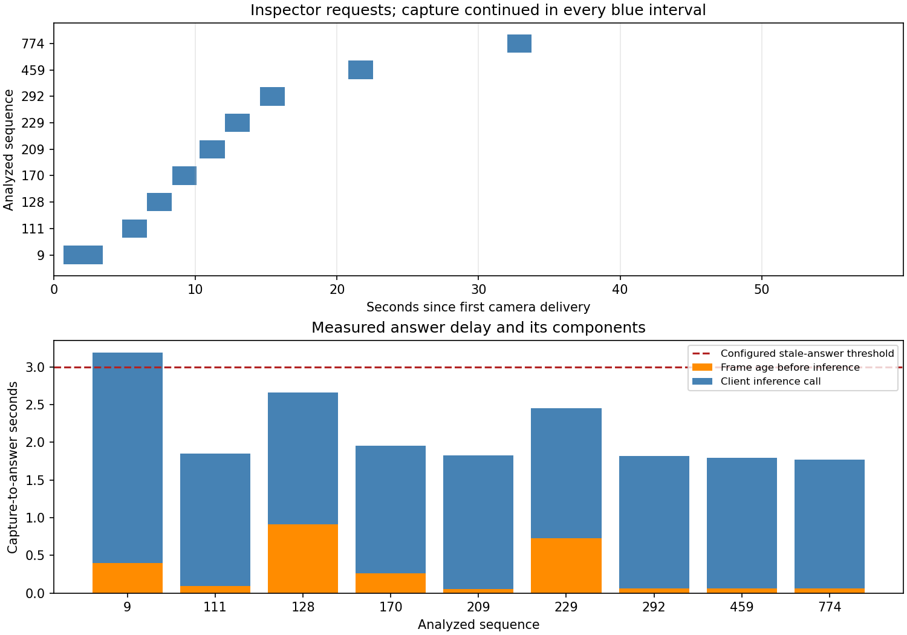

# First successful concurrent camera benchmark — November 12, 2026

## Meeting takeaway

**The two-model pipeline successfully captured live CSI images while producing VLM
answers on the Jetson Orin Nano.** It delivered 1,569 frames at **26.14 FPS** and
completed **nine answers**, with **1.855 s mean inference** and **2.148 s mean
host-capture-to-answer delay**. Sampled peak whole-system RAM was **4,864 MB**.
Capture continued during every Inspector request. Exit status was 0, with no
recorded worker errors or blocked workers.

This is a successful **live concurrency smoke test**, not a completed five-video
construction benchmark or verified hazard-detection accuracy result. Four analyzed
images were alignment/room views, only five clearly showed the construction source,
and eight answers hit the output limit. The next priority is a clean five-video
repeat with alignment excluded and manual output review.

Primary evidence folder: `results/scout_live_20261112T181800536659876`. All statistics below are computed from its saved
files. Extended extraction: `results/scout_live_20261112T181800536659876/review_20261112T182849033578Z/metrics.json`. Reproduce without camera/model execution:

```bash
MPLCONFIGDIR=/tmp/scout_review_mpl .venv-scout/bin/python experiments/review_scout_run.py \
  results/scout_live_20261112T181800536659876 --plot
```

## What actually ran

| Component | Actual configuration / evidence |
|---|---|
| Hardware / camera | Jetson Orin Nano, 7,620 MB reported usable system RAM; IMX219 **CSI**, not USB. |
| Camera pipeline | Preserved `nvarguscamerasrc` sensor 0 → requested NVMM 1280×720/30 NV12 → 640×360 BGR → dropping, one-buffer appsink. Driver logs selected its 720p/60 sensor mode; application reported 30 FPS. Sensor-mode text is not measured delivery rate. |
| Scout | YOLO11n, 2,616,248 parameters from exporter output; checkpoint `ultralytics/assets` release v8.3.0. Ultralytics runtime 8.3.162; TensorRT 10.3.0 engine, requested FP16 with possible FP32 layers. |
| Scout sizes | Source `.pt`: 5,613,764 bytes; serialized engine: 9,463,447 bytes. These are files, not loaded RAM. |
| Engine build | Standalone `trtexec`, 640-square input, opset 17, 128 MiB workspace, builder optimization level 0, avgTiming 1. First-working engine, not maximally tuned. Full command/hash in saved export manifest. |
| Inspector | `ggml-org/SmolVLM2-500M-Video-Instruct-GGUF`, revision `ccd7aae53bcb1997355c2f094959e72b3642ce17`; llama.cpp source `2a4daf0e08d6a9b6993ee0d4a9a3cfc35a6f405c`. |
| Actual quantization | Requested Q4_K_M, but 193/291 tensors required fallback; quantizer reported **5.89 bits/weight**. Do not label it uniformly INT4. Separate vision/projector file remains F16. |
| Inspector file sizes | Text 303,253,504 bytes + projector 199,470,624 bytes = **502,724,128 bytes / 479.44 MiB**. This alone exceeds a 400 MB checkpoint budget; loaded footprint is unknown. |
| Server | Local CUDA-enabled llama.cpp, one slot, context 1,024, GPU offload requested, two CPU threads, F16 K/V cache. |
| Trigger | **Person presence**, confidence 0.4, max 50 detections, 250 ms minimum offer interval. Proximity, motion and missing-helmet rules were disabled. A trigger is a review hint, not a verified hazard. |
| Scheduling | One Scout capture/detection worker; one serial Inspector worker; `Queue(maxsize=1)` replaces pending triggered frames. Main-thread OpenCV windows. |
| Input / generation | Camera frames letterboxed to 384×384, JPEG quality 90 for HTTP; 32-token maximum, temperature 0, nonstreaming answer. Projector metadata specifies native 512×512, patch 16, scale factor 4; submitted 384 does not prove encoder/token reduction. |
| Start / stop | This run started timing at the first camera delivery, with **no alignment wait**. Automatic 60-second duration; graceful teardown, exit 0. No full continuous video file was saved. |

Sources: `results/scout_live_20261112T181800536659876/client/config.json`, `results/scout_live_20261112T181800536659876/client/run.json`,
`results/scout_live_20261112T181800536659876/provision-manifest.json`, `results/scout_live_20261112T181800536659876/client_terminal.log`,
`models/scout/yolo11n-fp16.json`,
`results/scout_provision_20261112T165840067947Z/quantize.log`.

Exact effective prompt, identical for these nine requests:

```text
Describe only clearly visible conditions in this construction image. In one short sentence, state the observation, location, and a possible safety concern if supported. If unclear, say so. Treat Scout triggers as unverified hints; do not invent hidden hazards, movement, missing PPE, or OSHA violations.
Scout review hints (not verified findings): [{"rule":"class_presence","label":"person"}]
```

Configured settings: `{"max_tokens": 32, "temperature": 0}`. The API reported
**224 prompt tokens per request**, output **31–32 tokens**, **287 output tokens
in total**. These are saved server usage counts, not estimates from answer length.
No separate measured visual-token count is available.

## Measured performance

| Metric | Result | Interpretation |
|---|---:|---|
| Timed camera span | 59.9881 s first-to-last delivery | Duration requested 60 s; startup excluded. |
| Delivered frames / FPS | 1,569 / **26.1385** | 87.13% of requested 30 FPS; not a sensor-drop count. |
| Largest delivery gap | **482.51 ms** | Capture continued, but not with perfectly stable cadence. |
| Inspector completions | **9** | Variable gated count; not nine regularly spaced samples. |
| Inference mean / median | **1.8550 / 1.7487 s** | Client backend call includes JPEG/request/response and model processing. |
| Inference range | **1.6982–2.7921 s** | First request was slowest. |
| First request / subsequent eight mean | **2.7921 / 1.7379 s** | Report cold and later requests separately; no hidden warmup removed from primary mean. |
| Five visually identified construction-frame mean | **1.7400 s**, n=5 | Post-hoc subset, not a separate controlled benchmark. |
| Frame age at inference start | **0.2928 s mean**, 0.0543–0.9100 s | Host delivery to request start; includes Scout, mailbox wait and persistence. |
| Capture-to-completed answer | **2.1478 s mean**, 1.7742–3.1926 s | Includes frame age plus inference; excludes unknown sensor/driver buffering. |
| Stale answers | **1/9**, 11.11% | Exceeded configured 3-second source-age threshold. |
| Inspector active time | **16.6952 s / 27.83%** of capture span | Gating left substantial idle time; not continuous VLM processing. |
| Actual full-run answer rate | **0.150 answers/s**, 9 per minute | Do not replace this with inverse inference latency. |
| Final answer received | **33.723 s** after first delivery | No new completed answer in the final **26.265 s**. |
| Worker/query errors / blocked workers | **0 / 0** | Saved status finished, stop reason duration. |

Sources: `results/scout_live_20261112T181800536659876/client/inspections.jsonl`,
`results/scout_live_20261112T181800536659876/client/scout.jsonl`, `results/scout_live_20261112T181800536659876/client/run.json`, `results/scout_live_20261112T181800536659876/review_20261112T182849033578Z/metrics.json`.



## Proof of concurrency and remaining contention

Every completed Inspector window overlaps later camera deliveries:

| Analyzed sequence | New camera frames delivered during its inference |
|---:|---:|
| 9 | 61 |
| 111 | 30 |
| 128 | 31 |
| 170 | 28 |
| 209 | 31 |
| 229 | 29 |
| 292 | 31 |
| 459 | 31 |
| 774 | 30 |

Total: **302 deliveries during 16.6952 seconds of Inspector work**. Maximum
simultaneously active Inspector calls reconstructed from timestamps: **one**.
This establishes concurrent host capture and inference requests. It does **not**
prove two GPU kernels executed simultaneously.

Pooled delivery rate was **18.09 FPS inside Inspector windows**, versus **29.27 FPS
outside**. Scout detection-call mean was **54.33 ms during** versus **29.91 ms
outside** those windows. These are count/time partitions and associated observations,
not controlled causal measurements. GPU/CPU contention, synchronization and scene
complexity can contribute. The current Scout combines capture and detection in one
worker, so slower detection also slows camera reads.

The `scout_frame_budget_misses=884` counter means loops longer than 33.33 ms;
**it is not proof of 884 lost sensor frames**. Read waiting is included in loop time.

Mailbox accounting is consistent:

- 1,569 frames = 1,543 untriggered + 26 person-triggered frames.
- 26 triggers = 16 mailbox offers + 10 cooldown exclusions.
- 16 offers = 9 completed + 4 replaced pending frames + 3 stale discarded frames.
- No pending frames remained at stop. No historical-image queue accumulated.

“Untriggered/nominal” means the rule did not fire, **not that 1,543 images were safe**.
Only 1.66% of delivered images triggered. Equipment-only hazards can be missed by
a person-only gate. Frames not saved cannot be retrospectively scored for misses.

Sources: `results/scout_live_20261112T181800536659876/client/scout.jsonl`,
`results/scout_live_20261112T181800536659876/client/inspections.jsonl`, `results/scout_live_20261112T181800536659876/review_20261112T182849033578Z/metrics.json`.

## RAM, loading and cache evidence

| Metric | Saved evidence / limit |
|---|---|
| Whole-session peak RAM | **4,864 MB**, 155 tegrastats samples, includes server startup and other processes. |
| Client-phase peak RAM | **4,861 MB**, 133 samples, mean 4,753.25 MB. Includes the already-running Inspector. |
| Whole-session mean RAM | 4,642.36 MB; startup/steady state mixed, not model footprint. |
| Inspector logged model-load interval | **7.4914 s**, first `loading model` to `model loaded`; includes projector/slot initialization, not a pure weights-copy timer. |
| Client Inspector `load_ms` | 1,432.71 ms **connection/artifact verification**, not model load. |
| Scout adapter load/warmup | 5,289.53 ms; includes initialization, synthetic warmup and verification. |
| Inspector loaded footprint / peak CUDA allocation | **Unknown / unknown**. External server is outside client PyTorch allocation tracking. |
| TRT context log | Shows 9 MiB context allocation, 15 MiB managed total at that point; **not total pipeline GPU memory**. |

Do not infer model footprint by subtracting RAM readings or comparing checkpoint
bytes to the old loaded footprint. Tegrastats records sampled whole-system RAM,
not dedicated per-model VRAM; short peaks between 500 ms samples can be missed.

The server actually reports **87 cached prompt tokens on each of the last eight
requests**, versus zero on the first; subsequent prompt processing uses 137 new
tokens rather than 224. Native prefix/KV reuse is therefore evidenced, but was
**not newly enabled by this refactor**. It is not proof of reuse of old image features
or temporal understanding. Logs also show 30–31 graph reuses per request and zero
graph reallocations. Neither cache nor graph contribution was isolated in an A/B test.

Mean server prompt-evaluation interval was **826.55 ms** (later eight **732.19 ms**);
mean decoding interval **955.32 ms** (later eight **949.09 ms**). Prompt evaluation
includes multimodal/prefix work; **it is not a standalone vision-encoder timer**.
The first-use difference cannot be attributed solely to the cache.

Sources: `results/scout_live_20261112T181800536659876/whole_session_tegrastats.txt`,
`results/scout_live_20261112T181800536659876/client/tegrastats.txt`, `results/scout_live_20261112T181800536659876/inspector_server.log`,
`results/scout_live_20261112T181800536659876/client/inspections.jsonl`, `results/scout_live_20261112T181800536659876/client/run.json`.
The server logged a projector `ffn up/down are swapped` warning; no request failure
was recorded. The live-stream OpenCV position-query warning likewise did not stop capture.

## Actual outputs and visual inspection

All nine analyses have a lossless resized PNG, exact submitted JPEG, JSON sidecar,
full effective prompt/settings and answer. The saved-file existence check passed
for every result. Images are `client/frames/frame_SEQUENCE` with eight-digit sequence
numbers. The inspection below is a qualitative review of those inputs, **not a
labelled accuracy study or verified hazard assessment**.

| Sequence / input time | Input review | Inference / answer delay | Finish |
|---|---|---|---|
| 9 / 0.277 s | Ceiling/partial face during alignment; mirror/white-shirt claim unsupported by visible input. | 2.792 / 3.193 s | length |
| 111 / 4.722 s | Room/window during alignment; lighting caption, not construction analysis. | 1.756 / 1.853 s | length |
| 128 / 5.685 s | Tilted room/monitor view; sleeping/bed claim not clearly supported. | 1.749 / 2.659 s | length |
| 170 / 8.102 s | Person holding camera/equipment; helmet/harness/vehicle claim unsupported by visible input. | 1.698 / 1.959 s | length |
| 209 / 10.254 s | Monitor shows orange excavator/operator; broad scene caption, no explicit supported safety concern. | 1.770 / 1.825 s | length |
| 229 / 11.371 s | Same source scene; generic equipment caption, cut off. | 1.729 / 2.455 s | length |
| 292 / 14.486 s | Excavator/operator and building; generic caption, cut off. | 1.762 / 1.822 s | length |
| 459 / 20.752 s | Excavator; claimed word “AQUA” is not supported by readable branding in the saved image. | 1.726 / 1.792 s | stop |
| 774 / 31.949 s | Monitor shows tilted excavator/soil; “in the process of digging” infers activity from one still and answer is cut off. | 1.713 / 1.774 s | length |

Full answers, exactly as saved (leading space omitted for readability):

**Frame 9** — [submitted image](../../results/scout_live_20261112T181800536659876/client/frames/frame_00000009.jpg)

> The image shows a person standing in a room with a large, circular mirror. The person is wearing a white shirt and appears to be looking at the mirror.

**Frame 111** — [submitted image](../../results/scout_live_20261112T181800536659876/client/frames/frame_00000111.jpg)

> The image depicts a dimly lit room with a single light source coming from the top left corner. The light is creating a halo effect around the edges of the

**Frame 128** — [submitted image](../../results/scout_live_20261112T181800536659876/client/frames/frame_00000128.jpg)

> A person is lying on a bed, seemingly asleep, with a pillow behind them. The room is dimly lit, with a pink wall in the background.

**Frame 170** — [submitted image](../../results/scout_live_20261112T181800536659876/client/frames/frame_00000170.jpg)

> A person is seated in a vehicle, wearing a helmet and a harness, with a large screen in front of them. The person appears to be operating a device

**Frame 209** — [submitted image](../../results/scout_live_20261112T181800536659876/client/frames/frame_00000209.jpg)

> The image captures a moment of a person operating a small excavator in a construction site. The excavator, painted in a vibrant orange, is equipped with a

**Frame 229** — [submitted image](../../results/scout_live_20261112T181800536659876/client/frames/frame_00000229.jpg)

> A person is operating a large, orange excavator in a construction site. The excavator is equipped with a bucket and a boom, and the person is seen

**Frame 292** — [submitted image](../../results/scout_live_20261112T181800536659876/client/frames/frame_00000292.jpg)

> A person is operating an excavator in a residential area, with a house in the background. The excavator is orange and has a large bucket on the end

**Frame 459** — [submitted image](../../results/scout_live_20261112T181800536659876/client/frames/frame_00000459.jpg)

> A person is operating an excavator in a construction site. The excavator is orange and has the word "AQUA" on the side.

**Frame 774** — [submitted image](../../results/scout_live_20261112T181800536659876/client/frames/frame_00000774.jpg)

> The image captures a moment of a construction site, where a large orange and black excavator is in the process of digging a trench. The excavator is positioned

Eight of nine ended with `finish_reason=length` at 32 output tokens. Several
end mid-sentence and several exceed the requested one-sentence form. Only frame
459 stopped naturally at 31 tokens. **Do not describe these as nine complete,
accurate hazard explanations.** Better alignment, framing and prompt adherence
are needed; reducing the cap further could worsen truncation. A larger cap could
increase delay and must be measured as a separate condition.

The construction source occupies only part of the camera image, with visible
monitor edges/reflections and the room/terminal around it. Letterboxing further
uses only 216 of 384 vertical pixels for the original 640×360 scene. This is
an input-quality issue as well as a model-capacity issue.

## Historical comparison: what can be said defensibly

| Condition | October 5 | October 22 | November 12 smoke test |
|---|---:|---:|---:|
| Model | Moondream 2B official 4-bit | Same pinned Moondream | YOLO11n + nominal 500M SmolVLM2 |
| Complete analysis requests | 30 / 5 videos | 30 / 5 videos | 9 / one mixed alignment/construction trial |
| Workflow | Record, then analyze | Record, then analyze | Concurrent live gated analysis |
| Mean inference | **8.3241 s** | **4.4612 s** | **1.8550 s** |
| Range | 6.1044–14.6789 s | 4.0908–11.3289 s | 1.6982–2.7921 s |
| Configured output cap | 96 | 16 | 32 |
| Prompt/task | Detailed safety description | Hazard label, ≤6 words | One-sentence visible observation/possible concern |
| Peak system RAM | 5,400 MB | 5,401 MB | 4,864 MB whole session; 4,861 client phase |
| Loaded VLM footprint | 1.8969 GiB | 1.8969 GiB | Unknown; 479.44 MiB is combined **file size** |
| Peak CUDA allocation | 2.4977 GiB, PyTorch metric | 2.4977 GiB, PyTorch metric | Unknown for combined pipeline |

Arithmetic across these recorded means gives **77.72% lower latency / 4.49× inverse
latency versus October 5**, and **58.42% lower / 2.40× versus October 22**. These
are **descriptive cross-configuration differences**, not controlled speedups on
identical inputs, not full-run answer-throughput gains, and not evidence of equal
quality. Do not add them to prior percentages. The historical whole-system RAM
peak difference is **9.93% lower versus 5,400 MB**, with different background loads,
measurement phases and tasks; do not attribute it solely to quantization/model size.

The most defensible improvement is architectural: **real camera capture now
continues while descriptions arrive**, rather than waiting for recording to finish.
The mean live answer delay is 2.148 s. October 22's logged ~930 s capture-to-answer
includes a long offline wait and is not an equivalent model-latency benchmark;
do not present a giant percentage reduction from that scheduling delay.

Historical exact model/revision: `moondream/moondream-2b-2025-04-14-4bit`,
`a89c59223ef8b5bb7826780728eeec172727ca84`.
Sources: `results/camera_v2-2~2026-10-05/analysis.json`,
`results/camera_analysis_20261022T163529601772802/analysis_fast.json`,
`docs/research-log/2026-10-22-camera-benchmark-comparison.md` (RAM/capture evidence),
and `results/scout_live_20261112T181800536659876/review_20261112T182849033578Z/metrics.json`.

## Five-video repeat: prepared, not launched

**Yes—repeat all five, with consistent framing and the same source order.** The
prepared launcher preserves source labels/URLs in a plan, uses unique per-video
results, and waits for **S** after alignment. No Inspector queries or timed capture
metrics are collected during alignment; no GUI handling moves off the main thread.

```bash
cd /home/charlotte/research
bash experiments/run_scout_five_videos.sh
```

| Video | Historical source label | Duration |
|---:|---|---:|
| 1 | Red Machine | 60 s |
| 2 | Video 2 | 35 s |
| 3 | Video 3 (legacy label `sVideo 3`) | 19 s |
| 4 | Video 4 | 25 s |
| 5 | Video 5 | 11 s |

Before each clip: prepare that same source paused at its beginning; press Enter
in the terminal to open the models/camera; fill the preview with the source video,
keep the camera steady; **press S in preview, then immediately start playback**.
The timer starts on the next delivered frame. Alignment can wait up to five
minutes; Q stops early and the batch records that partial result and stops. Models
restart per clip, so first-request/cold latency must stay visible in reporting.
No continuous video recording is added. Total video time is 150 s plus setup and
manual alignment; do not promise an exact total runtime.

Freeze the current prompt, output cap, model files, engine and gate for this first
clean five-video live repeat. The runner uses the existing person gate and
**variable answer counts**. It does **not guarantee six answers per video or 30 in
total**. Record zero-trigger scenes and incomplete answers honestly; they reveal
coverage problems, not failed sample bookkeeping.

For a genuinely matched six-samples-per-video comparison, a **separate periodic
latest-frame sampling arm** is needed, independent of the person gate, at the
historical target times `duration × (i + 0.5) / 6`. That sampling arm is a proposal,
not implemented in this runner. It must retain one active Inspector and a latest
pending frame; deadlines/misses must be recorded rather than accumulating old
frames. A slow query may prevent six completions in an 11-second clip. Never
claim equivalent n=30 simply because five videos were played.

After each run, retain: source identity/order, clean scene onset, actual counts,
FPS/gaps both during and outside Inspector activity, cold and subsequent latency,
frame age, answer delay/staleness, trigger/drop counts, RAM phases, token usage,
truncation rate and a manual supported/unsupported/incomplete answer review.
Only then aggregate and compare; no new experiments were launched in this review.

## Highest-value next improvements

1. **Input and quality first:** use aligned, stable, screen-filling source footage;
   review unsupported PPE/equipment/motion claims and truncation. Prompt-only
   success on Moondream does not transfer automatically to this smaller model.
2. **Gate coverage:** add a separately evaluated periodic fallback for scenes with
   no person detections; consider a trained construction detector later. Stock
   COCO labels do not supply construction machinery/PPE classes or safe-scene truth.
3. **Reduce active-phase capture stalls:** profile shared GPU/CPU contention; a
   separate acquisition worker with its own latest-frame slot could keep reads
   independent of Scout detection. This further split is **not implemented**.
4. **Tune after baseline:** the engine used builder level 0 to avoid the prior
   build failure. Evaluate a tuned standalone build later, or a lower Scout input
   size with small-person recall checks. Do not assume either improves quality.
5. **Measure missing costs:** retain server-stage timings, add a pure vision timer
   if supported, and instrument model/CUDA allocation separately. External-server
   unknowns cannot be filled by client Torch counters or checkpoint arithmetic.

## Meeting script

> We have now demonstrated concurrent CSI camera capture and language inference
> on the Jetson. The 60-second run delivered 26.14 frames per second and nine
> descriptions. Capture continued during every description request, while only
> one Inspector query ran at a time. Mean inference was 1.855 seconds and mean
> source-image-to-answer delay was 2.148 seconds, with peak system RAM of 4,864 MB.
> Compared with our recorded October means, latency is substantially lower, but
> we changed models, prompts and inputs, so it is not a controlled accuracy-preserving
> speedup. The key milestone is live operation. Quality and coverage are now the
> priority: early frames included camera alignment, several descriptions were
> unsupported, most hit the token cap, and a person-only gate skipped long stretches.
> We are ready for a clean five-video repeat, followed by a matched sampling and
> human-review study before making stronger real-time safety claims.

## Review changes and checks

Added offline `experiments/review_scout_run.py` and the saved plot/metrics; inspected
all nine submitted JPEGs and preserved full answers. Added optional
`--wait-for-start` and `--source-label`, plus `experiments/run_scout_five_videos.sh`.
Default launches without that flag retain immediate timing. The S-key arming path
is **CPU-contract tested, hardware untested**. It prevents both timed counters and
Inspector work before arming. Sixteen new-suite CPU tests and thirteen existing
experiment tests passed; Python/shell syntax checks passed. Test logs are saved in
this run's review folder. No camera/GPU experiment was rerun, no stack changed,
and no commit/push was made during this review.

## Follow-up: five-video batch interrupted after Video 1

Batch `results/scout_five_20261112T183825319910773` completed Video 1: four
answers, 1.9270 s mean inference, 2.1876 s mean answer delay, 28.6565 FPS, peak
system RAM 5190 MB. All four requests overlapped camera deliveries. This is
partial batch evidence, not the final five-video aggregate.

Video 2 preflight failed with address-in-use before loading models/camera.
Video 1 server log records cleanup; subsequent port probes find it free. The
preflight lacked SO_REUSEADDR and could reject a recently closed server's TCP
state. Added SO_REUSEADDR while continuing to reject a live listener. Added
`--resume PATH --from-video 2`; old raw results/failed attempts are retained,
new attempts get unique terminal logs. CPU tests and shell syntax pass; an EOF
resume check reaches the Video 2 prompt without hardware. No camera/GPU run was
launched during this repair. The full dataset remains incomplete.
