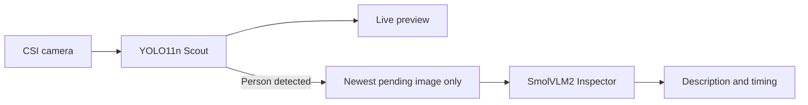
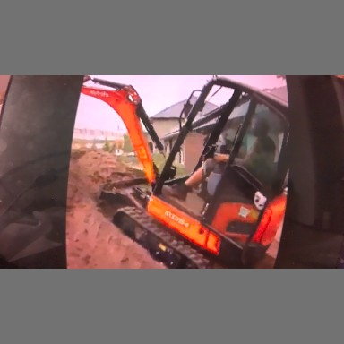
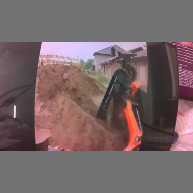

# Live Construction-Scene Analysis: Changes and Initial Results

**November 12, 2026 — NVIDIA Jetson Orin Nano, 8 GB unified memory**

## Main change

The system has moved from **recording images first and analyzing them afterward**
to **capturing live camera images while analysis runs independently**.

The new design uses two models. A small detector checks the incoming images;
a smaller vision-language model describes selected images. The live preview
continues updating while a description is being generated.

Only one Inspector request runs at a time. If another relevant image arrives
while it is busy, the newest pending image replaces the older one. This prevents
a growing backlog. Inputs older than the configured limit are discarded, and
late answers are marked stale.

This is **periodic live image analysis**. It does not establish verified temporal
event detection or generate a new description for every video frame.

## Models and processing

| Component | Previous approach | Current approach |
|---|---|---|
| Description model | Official 4-bit Moondream 2B | SmolVLM2-500M-Video-Instruct |
| Fast detector | None in the successful sequential benchmark | YOLO11n, 2,616,248 parameters |
| Detector execution | — | TensorRT engine, requested FP16 |
| Description execution | PyTorch/TorchAO | Local CUDA-enabled llama.cpp |
| Camera and analysis | Sequential | Concurrent |
| Pending images | Saved images analyzed later | At most one pending triggered image |
| Current trigger | — | Person presence; not a verified hazard |
| Description limit | 96 tokens on October 5; 16 on October 22 | 32 tokens, temperature 0 |

The description model is nominally **75% smaller in parameter count** than the
2B model. That does not imply a 75% reduction in RAM or equivalent accuracy.

The Inspector uses requested Q4_K_M quantization with higher-precision fallbacks:
193 of 291 tensors required fallback, and the quantizer reported **5.89 bits per
weight**. It is **not uniformly INT4**. The separate vision/projector file remains
F16. Their combined file size is **502,724,128 bytes, or 479.44 MiB**; loaded model
footprint and total CUDA allocation have not been independently measured.
The Scout engine is **9,463,447 bytes**. File sizes are distinct from runtime RAM.

The camera is the existing **IMX219 CSI camera**. Its established pipeline requests
1280×720 at 30 FPS and produces 640×360 images. Inspector inputs are letterboxed
to 384×384. The vision model has a native 512×512 image configuration, so submitted
image size alone does not establish reduced visual-token processing.

## Initial measured results

| Measurement | First concurrent trial | Later aligned Video 1 trial |
|---|---:|---:|
| Timed capture | Approximately 60 s | Approximately 60 s |
| Delivered camera images | 1,569 | 1,720 |
| Measured camera delivery rate | **26.14 FPS** | **28.66 FPS** |
| Completed Inspector responses | **9** | **4** |
| Mean inference latency | **1.855 s** | **1.927 s** |
| Inference range | 1.698–2.792 s | 1.272–3.336 s |
| Mean image age when inference began | 0.293 s | 0.261 s |
| Mean capture-to-answer delay | **2.148 s** | **2.188 s** |
| Sampled peak whole-system RAM | **4,864 MB** | **5,190 MB** |
| Requests with camera capture continuing | **9/9** | **4/4** |
| Recorded worker errors | 0 | 0 |

RAM was sampled with tegrastats every 500 ms and includes the whole system,
models and other processes. These peaks are not per-model memory measurements.
Neither test establishes a sub-400 MB runtime.

The first trial included camera alignment and room views. Only five of its nine
analyzed images clearly showed the construction source. The later trial excluded
alignment from timed capture. Counts vary because only person-triggered images
are offered to Inspector; neither trial is a fixed six-images-per-video benchmark.
The five-video collection remains incomplete in the saved evidence reviewed here.

## Evidence that capture and inference overlapped

These examples use camera-delivery timestamps inside the actual Inspector
request intervals, rather than relying on visual impressions alone:

| Trial / analyzed image | Inference duration | New camera images delivered during inference |
|---|---:|---:|
| First trial, image 209 | 1.770 s | **31** |
| First trial, image 292 | 1.762 s | **31** |
| First trial, image 774 | 1.713 s | **30** |
| Later trial, image 193 | 3.336 s | **77** |
| Later trial, image 1480 | 1.364 s | **22** |

Across the first trial, **302 new camera images arrived during 16.695 seconds of
Inspector processing**. Reconstructed Inspector request overlap never exceeded
one active request. This demonstrates concurrent camera delivery and model
requests; it does not establish simultaneous execution of GPU kernels.

Capture still slowed while Inspector was active. In the first trial, pooled
camera delivery was approximately **18.09 FPS during inference** and **29.27 FPS
outside those intervals**. Shared GPU/CPU contention and synchronization remain
possible constraints; they have not been isolated experimentally.

## Description quality: useful captions and clear failures

The earlier trial produced several plausible construction captions, but neither
trial has a validated accuracy score. The first trial also contained unsupported
room descriptions. Speed and concurrency must be assessed separately from quality.

**Earlier example — image 292:**

> A person is operating an excavator in a residential area, with a house in the background.

This is an excerpt from a longer, token-limited response. It broadly matches the
visible equipment and setting; it does not verify movement or establish a hazard.

**Later example — image 1573:**

> A person is using a large green excavator to dig into a dirt mound.

The saved input shows orange equipment; the claimed green color is unsupported.
The response also describes activity that one independent image cannot verify.

Another later response introduced a surrounding group of people and helmets that
are not supported by the saved image. In contrast, image 1480 produced a broadly
plausible caption of a seated excavator operator, although stationary/moving status
still cannot be verified from that still.

**Eight of nine** responses in the first trial and **two of four** in the later
trial reached the 32-token limit. Several ended mid-sentence. These are completed
API responses, not necessarily complete or reliable explanations. Many are generic
scene captions rather than useful safety observations.

Camera angle, reflections, monitor borders and the small visible source area also
reduce input quality. The evidence does not establish why the later trial appeared
less accurate, or that model accuracy changed between trials.

## Progress relative to earlier results

| Experiment | Samples | Mean inference | Capture and analysis |
|---|---:|---:|---|
| October 5 | 30 across five videos | 8.3241 s | Sequential |
| October 22 | 30 across five videos | 4.4612 s | Sequential |
| November 12 first concurrent trial | 9 mixed inputs | 1.8550 s | Concurrent |

The new mean is **77.72% lower than October 5** and **58.42% lower than October 22**.
These are descriptive differences between configurations, **not a controlled,
accuracy-preserving speedup**: model, prompt, token limit, image processing,
sample count and scene content changed. They also do not represent the full-run
answer rate: the first trial delivered nine answers in a minute, with long idle
gaps caused by the gate.

Existing KV caching was already present in the earlier model. The current backend
also shows native prefix reuse: eight later requests in the first trial reused
87 prompt tokens each. This was not a newly enabled cache optimization and does
not imply reuse of old image understanding or temporal context.

## Current limitations and next priorities

- **Coverage:** person-only triggering can miss equipment-only scenes. An
  untriggered image is not a verified safe image. The first trial had no new
  completed answer during its final 26.26 seconds.
- **Reliability:** unsupported objects, colors, PPE and activity claims require
  manual review. Generated hazard statements remain unverified.
- **Output completeness:** the response format and token limit need separate
  evaluation; simply shortening the limit could increase truncation.
- **Performance:** maintain stable capture while Inspector runs, and measure
  model/CUDA memory separately from whole-system RAM.
- **Evaluation:** complete a clean, consistently framed five-video live trial.
  Keep actual answer counts, delays, staleness, truncation and unsupported claims.
  A matched six-samples-per-video comparison requires a separate sampling design;
  person-gated output does not guarantee 30 answers.

The demonstrated milestone is **working live concurrency within the tested RAM
budget**. Reliable construction observations and complete coverage remain open work.

## Saved evidence

- First trial: `results/scout_live_20261112T181800536659876/`.
- Later trial: `results/scout_five_20261112T183825319910773/video_01/scout_live_20261112T183833452767628/`.
- Per-trial `client/scout.jsonl` and `client/inspections.jsonl`: capture/query times,
  detections, exact prompts, settings, token counts and responses.
- Per-trial `client/frames/`: analyzed images and answer sidecars.
- Per-trial `whole_session_tegrastats.txt`: raw system-memory evidence.
- Inspector revision: `ccd7aae53bcb1997355c2f094959e72b3642ce17`.
- llama.cpp source revision: `2a4daf0e08d6a9b6993ee0d4a9a3cfc35a6f405c`.
- Historical measurements: `results/camera_v2-2~2026-10-05/analysis.json` and
  `results/camera_analysis_20261022T163529601772802/analysis_fast.json`.
