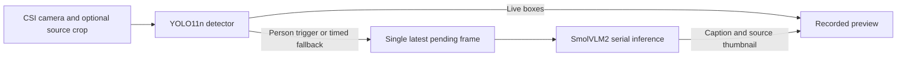

# Research meeting log · November 24, 2026

The five recorded clips demonstrate live CSI camera capture, YOLO detection, and SmolVLM captions on the Jetson Orin Nano. **Camera frames arrived during all 111 completed SmolVLM requests.** The system can describe selected live images, but its descriptions still miss relevant conditions and sometimes invent details. Falls, rollovers, obstructions, and other hazards have yet to be validated.

## How the system works

The pipeline uses **two models, with one VLM**. YOLO11n is a vision-only object detector. It takes an image and returns a trained class label such as `person`, a bounding box, and a confidence score for each detection. SmolVLM2-500M is the vision-language model (VLM). It takes a selected image and a written prompt and generates a caption.

1. **Capture.** The CSI camera delivers frames while the preview stays live. A selected crop limits both models to the source footage. Clips 1–3 used a crop and clips 4–5 used the full frame.
2. **Detect and select.** YOLO11n runs through TensorRT and produces object classes, boxes, and confidence scores. Those boxes appear on the live image. A person detection can trigger an analysis offer. After 500 ms without an offer, the focused profile can submit the latest frame through its fallback, so an equipment scene can be sampled even when nobody is detected.
3. **Describe.** One SmolVLM2-500M worker analyzes one 384×384 image at a time, using the prompt and short Scout hints on detection-triggered requests. The boxes stay on the preview. The selected camera image goes to SmolVLM. While it works, the newest offered frame can replace the single pending frame. A frame that has aged out is discarded before inference. This keeps analysis from working through a backlog.
4. **Display and record.** The preview shows the current YOLO boxes and camera count. It also shows the last caption with its own source thumbnail, age, and request timing. The boxes show what YOLO sees now. The caption describes the earlier image shown beside it. The recording preserves this view, including the advancing camera count during inference.

**Why use both?** YOLO helps answer “where is a familiar object, and should we offer this frame for analysis?” SmolVLM answers “what does this selected image appear to show?” Without YOLO, periodic sampling can still keep one VLM request running alongside capture. That setup gives up the live boxes and person-based selection. The five-video run demonstrated the two-model pipeline. A matched comparison with SmolVLM alone would tell us whether YOLO improves coverage or reduces VLM workload enough to justify its cost. YOLO's stock classes have limited construction coverage, and a person box does not establish a hazard.

## Recorded results

| Clip | Camera FPS | Answers | Mean inference | Mean capture-to-answer | What to show |
|---|---:|---:|---:|---:|---|
| [1 · Excavator](../../results/scout_five_20261124T160831624025736/playback/video_01.mp4) | 16.72 | 44 | 1.354 s | 1.692 s | At **0:17**, the caption recognizes an excavator while the live preview continues. At **0:51**, it recognizes the machine but misses its pronounced tilt and guesses the brand. |
| [2 · Woodworking](../../results/scout_five_20261124T160831624025736/playback/video_02.mp4) | 15.53 | 25 | 1.397 s | 1.623 s | At **0:32**, the caption describes a person working with a power tool. It gives activity context and leaves specific obstructions and hazards unassessed. |
| [3](../../results/scout_five_20261124T160831624025736/playback/video_03.mp4) | 15.67 | 14 | 1.343 s | 1.609 s | At **0:14**, the model calls the object a cloud. Its submitted image shows people outdoors and prominent screen glare. |
| [4](../../results/scout_five_20261124T160831624025736/playback/video_04.mp4) | 16.19 | 19 | 1.323 s | 1.553 s | At **0:20**, the model reports that the equipment is unclear. This is a useful example of abstention, especially given the varied labels elsewhere in the clip. |
| [5 · Tracked machine](../../results/scout_five_20261124T160831624025736/playback/video_05.mp4) | 15.68 | 9 | 1.262 s | 1.479 s | At **0:07**, the caption calls a compact tracked machine a damaged SUV. This shows why equipment identity needs stronger evidence before it carries forward. |

Across the 111 answers, mean inference was **1.349 s**, mean frame age when inference started was **0.276 s**, and mean capture-to-answer delay was **1.625 s**. Peak whole-system RAM was **4,413 MB**. **39 answers hit the 32-token limit.** The MP4s are H.264 copies of the original application recordings and keep their playback timing. They play at **10 FPS**. The table reports measured camera delivery during the recorded runs.

The tested prompt focused on equipment and posture, and explicitly excluded inference about movement or falls. It did not request an inventory of obstructions. A missing obstacle in those captions cannot be interpreted as a clear path. The glare, unstable equipment labels, and missed tilt show why a fluent caption alone is weak evidence for a hazard.

## What to improve next

- **Prompt.** Test a compact response format such as `Equipment | Visible obstruction | Posture | Unclear`. Ask for where each visible obstruction is and use “unclear” if the view is blocked. Compare the existing 32-token cap with a larger cap on the same images and measure truncation, unsupported claims, and delay.
- **Short-term video context.** Start with a small rolling record of timestamped tracker observations per object, such as its ID, location, and posture. Use a stable label when several observations agree. When they conflict, report uncertainty and allow the label to change when new evidence supports it. Expire tracks after occlusion or a scene change and reset them at each clip. Avoid using past captions as facts, since that could reinforce an early mistake. For a suspected event, retain a bounded set of before, during, and after frames for comparison. This is proposed application memory. The current model requests use independent images.
- **Models and measurement.** Keep YOLO and SmolVLM as the baseline. Test person tracking and pose cues for falls, and construction-specific detection or orientation cues for machinery tip-overs. If SmolVLM still misidentifies equipment on clean, labelled inputs, compare a stronger VLM on the same inputs under the Jetson's RAM and latency constraints. Score event recall, false alarms per minute, and time to alert against labelled event windows.
- **Recording and inputs.** Use the existing app recording for the live demonstration. Frame the screen tightly, reduce glare, and keep the camera fixed. Retain the MP4 and its timing logs together. For a controlled follow-up, feed the original video files directly to the pipeline to remove reflections and alignment from the accuracy comparison. Keep recording conditions consistent when comparing performance, because recording adds work.

The longer results note contains the exact prompt, model revisions, full timing evidence, and submitted images for the example errors. [Detailed five-video results](2026-11-24-five-video-results.md)
