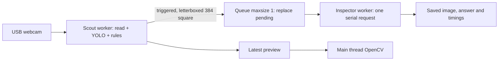

# USB Scout & Inspector — implementation and deployment

Updated November 12, 2026. **Implemented and provisioning authorized; no new camera/GPU benchmark.**
For this machine, prefer [the provisioned quickstart](scout-inspector-quickstart.md) and the [setup evidence](research-log/2026-11-12-scout-inspector-provisioning.md).

## Repository audit

| Path | Decision |
|---|---|
| `experiments/moondream_4bit_camera_v2.py` | Preserve October baseline, pinned model and loading workaround unchanged. |
| `experiments/moondream_4bit_camera_live.py`, live comparison and saved-control scripts | Historical/experimental paths; superseded for the new USB scope, preserved rather than deleted. Existing CSI pipeline remains available. |
| `results/`, `docs/research-log/` | Preserve all evidence, including failures. |
| `main.py` | New USB pipeline entry point; no old primary application was replaced. |
| `src/scout_inspector/core.py` | Trigger rules, frame metadata, thread-safe one-slot queue. |
| `src/scout_inspector/backends.py` | USB/V4L2, local YOLO TensorRT engine, local llama.cpp HTTP or Transformers FP16 adapters. |
| `src/scout_inspector/runtime.py`, `cli.py` | Two workers, main-thread preview, finite run, evidence and shutdown. |
| `configs/scout_inspector.example.json` | Editable example. Requires exact artifact revision and local assets before launch. |
| `experiments/export_scout.py` | Explicit local engine export with provenance manifest. Never auto-runs. |
| `tests/test_scout_inspector.py` | CPU fake-backend contract tests. |

## Data flow and guarantees



Scout never waits for Inspector generation. Its own capture, detection, resizing
and logging are serial. It requests 640×480 MJPEG at 30 FPS with one driver buffer;
actual properties, delivered FPS, maximum delivery gap and missed frame budgets
are recorded. **30 FPS is a target, not a lock or a measured result.** Both models
share GPU resources: threading does not prevent CUDA contention or OOM.

One inference can be active and at most one triggered image pending. New triggers
replace pending images. Nominal frames are discarded; only the latest preview
is retained. Inspector discards frames older than 1,000 ms before starting,
including a second freshness check after saving the image. Answers older than
3,000 ms are marked stale. These thresholds are configurable; they do not promise
answers within the present second. Timestamp is host delivery after `read()`,
not sensor exposure: unknown USB/driver buffering is excluded from measured age.

Initialization loads/verifies Inspector, warms Scout, then opens USB camera. This
avoids camera-buffer allocation during model loading but does not prove memory
will fit. Main thread alone handles OpenCV windows. Ctrl+C, SIGTERM, Q, or duration
stops both workers. Joins share a bounded shutdown deadline. A hung native call
may prevent clean release: partial `run.json` identifies blocked workers and the
CLI force-exits. It never kills an externally managed llama.cpp server. HTTP
requests have a timeout; stopping the client does not guarantee remote generation
was cancelled. A completed response is preserved even after a stop request.

## Trigger semantics

- Default: person near `car`, `truck`, or `bus`, using normalized bounding-box gap.
  These are **vehicle proxies**, not a trained construction-machinery classifier.
- Optional configured class presence and image-plane centroid motion triggers.
  Motion is a heuristic with nearest-position matching, not validated tracking,
  physical speed, or temporal event recognition.
- Missing-helmet heuristic is disabled. Enabling requires actual helmet classes
  in a custom detector. No helmet box can also mean occlusion/detector failure.
- Unsupported configured classes fail at startup. Stock COCO weights cannot
  establish absent PPE or identify arbitrary construction equipment.
- Inspector gets exact saved prompt plus at most two unverified Scout hints, `max_tokens=32`,
  `temperature=0`. Generated observations are not verified hazards or OSHA findings.

## Setup without replacing the Jetson stack

Provisioning evidence records the commands actually executed. Preserve existing
PyTorch/CUDA/TorchAO/Transformers. No sudo, vLLM or host dependency upgrades.
Use a dedicated optional environment exposing the already working stack:

```bash
python3 -m venv --without-pip --system-site-packages .venv-scout
source .venv-scout/bin/activate
# Existing pip is available through system site packages on this machine.
python -m pip install --no-deps ultralytics==8.3.162 ultralytics-thop==2.0.9 \
  seaborn==0.13.2 onnx==1.17.0 protobuf==4.25.8 py-cpuinfo==9.0.0
python -m pip check
```

This optional installation command deliberately does not resolve/replace Torch.
Inspect missing dependencies before adding compatible, explicitly pinned packages
inside that environment; do not run an unrestricted Ultralytics dependency install.
Ultralytics automatic installation is disabled by the adapters/exporter. ONNX
export packages must already be available or be supplied separately in the optional
environment. Installed TensorRT was observed as 10.3.0; do not upgrade it for this
recipe. FP16 is the initial path. INT8 requires representative local calibration
images and separate detection-quality validation. Engine export is a GPU operation;
wait for permission/readiness before executing it.

1. Obtain a trusted local YOLO11n or YOLOv8n `.pt` checkpoint; record its exact
   source release/commit. Do not assume either recognizes PPE or all machinery.
2. Build the engine **on this Jetson**, with Inspector stopped to avoid export
   workspace competing with inference memory. Use a fresh source directory:

```bash
python3 experiments/export_scout.py \
  --weights models/scout/source/yolo11n.pt \
  --revision EXACT_SOURCE_RELEASE_OR_COMMIT \
  --output models/scout/yolo11n-fp16.engine --precision fp16 --imgsz 640
```

For INT8 use a new output name, `--precision int8 --calibration-data /absolute/local/data.yaml`.
The YAML must resolve to existing representative local images. Preserve that dataset;
the exporter hashes the YAML, not every calibration image. Do not let the exporter
download a sample calibration dataset. Review engine outputs before using them.
Export records checkpoint and engine SHA256, byte size, precision settings and
package versions. Existing engine/manifest paths are rejected.
The API recipe is tied to [Ultralytics v8.3.162 TensorRT documentation](https://raw.githubusercontent.com/ultralytics/ultralytics/v8.3.162/docs/en/integrations/tensorrt.md),
which describes FP16 and calibrated INT8 engine export. Current online examples
may target a different Ultralytics/TensorRT generation.

### Inspector: initial INT4 deployment path

Use [SmolVLM2-500M](https://huggingface.co/HuggingFaceTB/SmolVLM2-500M-Video-Instruct)
with [ggml-org GGUF artifacts](https://huggingface.co/ggml-org/SmolVLM2-500M-Video-Instruct-GGUF/tree/main).
Provisioned HF commit: `ccd7aae53bcb1997355c2f094959e72b3642ce17`; llama.cpp
source commit: `2a4daf0e08d6a9b6993ee0d4a9a3cfc35a6f405c`. Keep revisions pinned. The inspected official GGUF repository offered F16/Q8_0;
**do not assume it has a downloadable Q4_K_M filename**. Obtain its F16 text model
and matching projector at the same exact revision, then locally quantize the text
model to Q4_K_M with `llama-quantize`. Keep the projector separate, usually at
higher precision. Save original filenames/revision, hashes and quantization command
beside the artifacts. Config paths may point to these files under convenient local
names `model-Q4_K_M.gguf` and `mmproj.gguf`; these are local names, not claimed Hub filenames.

Build a separately pinned llama.cpp checkout under ignored `dependencies/` using
existing compiler/CMake/CUDA tools. No system installation is needed:

```bash
# In a separately acquired, pinned dependencies/llama.cpp checkout:
cmake -S dependencies/llama.cpp -B dependencies/llama.cpp/build \
  -DGGML_CUDA=ON -DCMAKE_CUDA_ARCHITECTURES=87
cmake --build dependencies/llama.cpp/build --parallel 2 \
  --target llama-server llama-quantize
# F16_INPUT is the actual downloaded local text model, not the projector:
dependencies/llama.cpp/build/bin/llama-quantize \
  "$F16_INPUT" models/inspector/model-Q4_K_M.gguf Q4_K_M
```

Inspect `llama-server --help` at the pinned commit. With supported flags, start
**one** local Inspector server, preserve startup logs, and monitor its load too:

```bash
mkdir -p results
server_run="results/inspector_server_$(date -u +%Y%m%dT%H%M%S%N)"
mkdir "$server_run"
tegrastats --interval 500 > "$server_run/tegrastats.txt" &
tegra_pid=$!
dependencies/llama.cpp/build/bin/llama-server \
  -m models/inspector/model-Q4_K_M.gguf \
  --mmproj models/inspector/mmproj.gguf \
  -ngl 99 -c 1024 --parallel 1 --host 127.0.0.1 --port 8080 \
  > "$server_run/server.log" 2>&1 &
inspector_pid=$!
printf 'Server PID=%s telemetry PID=%s logs=%s\n' "$inspector_pid" "$tegra_pid" "$server_run"
# After client finishes, stop these specific processes:
# kill "$inspector_pid" "$tegra_pid"
```

Server log supplies its own model-load/runtime buffer evidence. Inspect context
length errors: 1,024 is a starting cap, not proof the multimodal prompt fits.
Changing context changes cache memory. The client probes `/v1/models` and sends
one image per `/v1/chat/completions` request. [llama.cpp multimodal documentation](https://raw.githubusercontent.com/ggml-org/llama.cpp/master/docs/multimodal.md)
confirms SmolVLM2 support and separate model/projector loading. CUDA projector
offload is default there; `--no-mmproj-offload` trades GPU use for CPU work and
must be a separately measured configuration.

The server must be started with exactly the files configured in the client;
client file hashing cannot prove what another process loaded. Preserve source
commit/build settings and server log with the run. Client `load_ms` measures
connection/artifact verification, **not server model loading**; `model_load_ms`
and loaded footprint are explicitly null rather than invented. External server
CUDA allocation is also null in client metrics. Tegrastats measures whole-system
RAM; do not relabel it CUDA allocation.

### FP16 fallback

An optional local Transformers adapter uses the existing stack, FP16/SDPA and
`local_files_only=True`. Set backend to `transformers`, model ID to
`HuggingFaceTB/SmolVLM2-500M-Video-Instruct`, revision to its exact 40-character
commit, and model path to a complete matching local snapshot directory. This is
**not INT4** and has not been hardware validated. Image splitting is disabled and
processor size constrained. Internal patch/visual token behavior remains model
specific: a 384-square submitted image alone does not prove a fixed token count.
Newer LFM2.5-VL is not wired in; do not upgrade Transformers to force compatibility.

## Run when camera is ready

Copy the example to `configs/scout_inspector.local.json`, set revision and actual
paths, and verify the installed packages/assets. Paths are relative to repository
working directory, not config-file directory. The example intentionally fails
until an exact artifact revision is provided.

```bash
cd /home/charlotte/research
python3 main.py --config configs/scout_inspector.local.json --check
# ONLY after Inspector server is ready and camera readiness is confirmed:
python3 -u main.py --config configs/scout_inspector.local.json --duration 60 --preview
```

A unique results folder is selected automatically; `--run` may specify another
new path. Tegrastats starts automatically for the client run. Model startup is
excluded from duration; the timer starts at the **first delivered USB frame**,
without an S-key alignment phase. Align and prepare the familiar source beforehand;
start playback when preview appears. Q/Ctrl+C stops early; at 60 seconds it stops
capture and asks Inspector to stop, then permits bounded shutdown. Thus total
wall time includes startup and shutdown. This new path saves analyzed images,
not a full video recording: continuous disk recording was deliberately omitted
to avoid adding writer overhead to the first live test.

## Evidence and acceptance criteria

| Evidence | What is actually stored |
|---|---|
| `config.json` | Exact model ID/revision, base prompt, token cap, temperature, camera and trigger settings. |
| `run.json` | Status, errors, model artifacts/hashes, byte sizes, adapter load timing, available footprint/CUDA statistics, counters, delivered FPS/gaps, sampled system RAM peak. |
| `scout.jsonl` | Every delivered sequence/timestamp, read/detection/loop time, labels/boxes/triggers and pending replacements. No full frame history. |
| `inspections.jsonl` and `frames/*.json` | Started/completed records, exact effective prompt, settings, answer, delivery timestamp, frame age, inference duration and capture-to-answer delay in ms, stale flag, actual token usage only where supplied/measured. |
| `frames/*.png`, `*.jpg` | Lossless resized analyzed frame; for HTTP, also exact JPEG bytes submitted to Inspector. |
| `tegrastats.txt` | Raw whole-system memory samples including other processes; summary reports sampled peak, not an instantaneous guaranteed maximum. |

Transformers records loaded footprint and PyTorch allocation/peak; PyTorch excludes
external server and some TensorRT allocations. GGUF checkpoint bytes include neither
runtime cache nor activation buffers. **A sub-400 MB runtime is a target, not a
result or a condition this code can guarantee.** The process retains bounded frames,
not bounded model workspaces. Existing Moondream KV cache was already implemented;
this refactor adds scheduling and gating, not a newly enabled Moondream cache.
Each image gets a fresh request; no cross-image prefix reuse is claimed.

First hardware acceptance: no fatal allocation failures; both models loaded;
Scout continues delivering while Inspector is active; queue stays at most one;
no overlapping Inspector queries; actual useful answers saved; FPS, gaps,
replacement count, answer age and whole-system RAM are acceptable. Compare
prompt/model quality on labelled construction examples before calling it improved
accuracy. No before/after speedup is defensible until this new path is measured.
